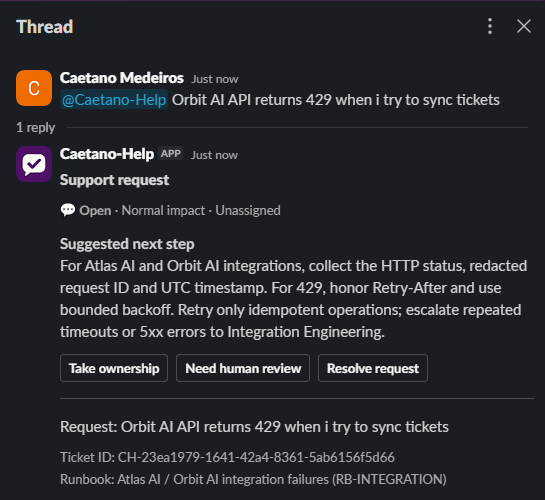
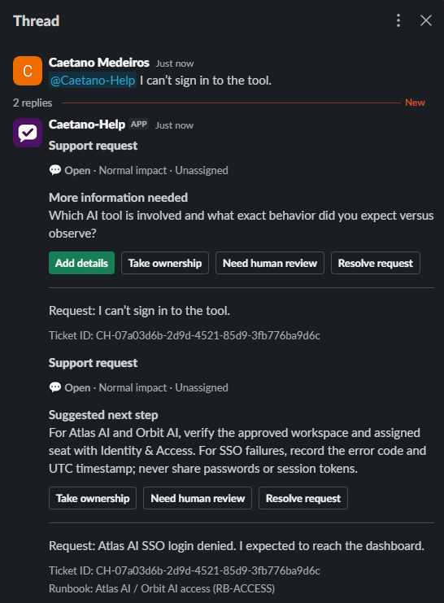
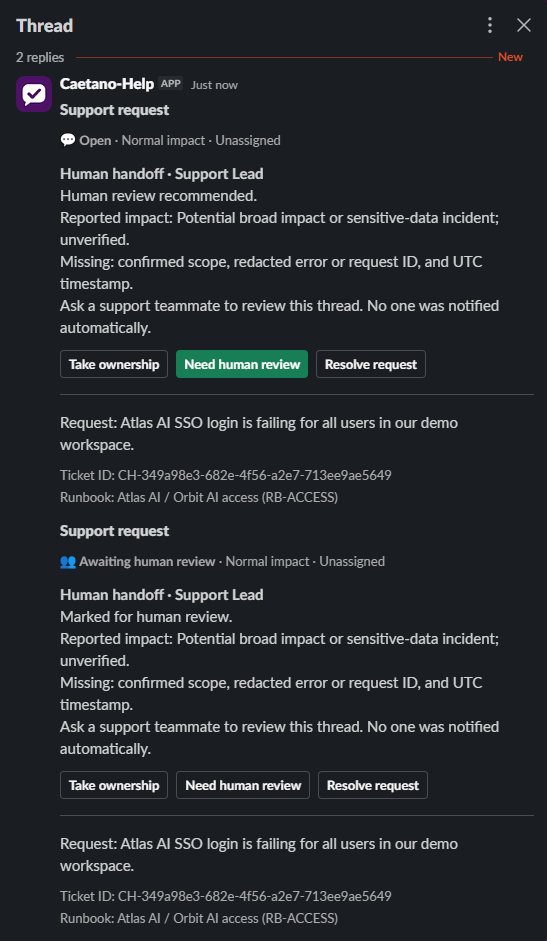
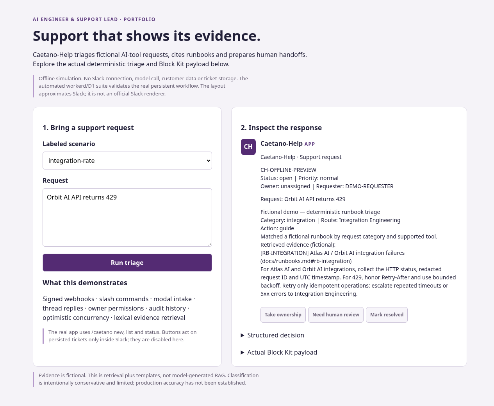

# Caetano-Help

Caetano-Help is a Slack app for AI-tool support. It turns a mention or form
submission into a tracked ticket, looks for relevant runbook guidance, and
keeps follow-up in the Slack thread. Tickets and their audit history live in
Cloudflare D1.

## See it in Slack

### 1. Get guidance for an API error

A mention about an Orbit AI sync returning `429` opens a ticket. The bot replies in the thread with guidance on
`Retry-After` and cites the integration runbook.

<p align="center">
  
</p>

### 2. Add context to an existing ticket

1. **Open a request.** The requester writes “I can’t sign in to the tool.” The
   first card asks which tool is affected and what happened.
2. **Click Add details.** In the form, the requester enters “Atlas AI SSO login
   denied. I expected to reach the dashboard.” and selects **Save details**.
3. **Get a suggested next step.** The bot posts the second card in the same
   thread, cites `RB-ACCESS`, and keeps the original ticket ID.

<p align="center">
  
</p>

### 3. Escalate a request for human review

A reported workspace-wide login issue prompts a recommendation for human review.
Selecting **Need human review** moves the ticket to **Awaiting human review** and
keeps the handoff summary in the thread.

<p align="center">
  
</p>

## Try the demo

The local demo shows how the app classifies a request, what evidence it found,
and the Slack card it would send. Try an API rate limit and then a vague request
to see when the app offers guidance and when it asks for more context.



With **Node.js 24** and **Python 3** installed:

```bash
npm ci
npm run demo:build
python -m http.server 4173 --directory dist/demo --bind 127.0.0.1
```

Open [the local demo](http://127.0.0.1:4173). It runs the same triage and card
rendering code as the Worker. The preview approximates Slack's layout and uses
sample data. It makes no Slack calls and needs no credentials. The
[five-minute walkthrough](docs/DEMO.md) includes sample requests and a tour of
the ticket lifecycle.

## Use it in Slack

| Action | How |
| --- | --- |
| Get quick triage in a thread | Mention `@Caetano-Help` with a brief description |
| Open a request with an impact level | `/caetano-help new` |
| Turn an existing message into a request | **More actions → Create support ticket** |
| Clarify a request and run triage again | **Add details** on a card that asks for more information |
| See your recent requests in this channel | `/caetano-help list` |
| Retrieve a ticket's status, history, and current card | `/caetano-help status CH-…` |
| See unresolved requests in this channel | `/caetano-help queue` (support role) |

Support can take ownership. Requesters can ask for human review or resolve
their own tickets. Human review records an escalation and prepares a handoff
summary in the thread. It does not page anyone. Use fictional or redacted
details because ticket cards are visible to members of the channel.

## How it works

The TypeScript Worker verifies signed Slack events, commands, and interactions.
It acknowledges incoming requests promptly and uses background work to save
tickets and publish Block Kit cards. Triage matches the request against a small
set of [fictional runbooks](docs/runbooks.md). It cites a matching source, asks a
focused question when context is missing, or recommends human review. The rules
are deterministic and need no model API.

- [Slack handlers](src/support.ts) open forms, validate submissions, and handle ticket actions.
- [Ticket storage](src/tickets.ts) scopes access by workspace and channel, deduplicates intake, and guards updates with ticket versions.
- [D1 migration](migrations/0001_tickets.sql) defines ticket tables and records audit entries in the same write as each state change.
- [Architecture](docs/ARCHITECTURE.md) includes the request flow, authorization rules, and delivery tradeoffs.

Slack acknowledgements and message delivery are separate from persistence.
Each delivery key allows at most one automatic post attempt. If a post fails
after a ticket was saved, use `list` or `status` to recover the current state.

## Develop and test

```bash
npm ci
npm run test:types
npm test -- --run
npm run eval
```

The tests run the Worker with local D1 and mock Slack HTTP calls. Vitest disables
remote bindings because the workflow tests reset ticket tables. The evaluation
checks category, route, action, and source IDs against 24 synthetic regression
cases. See the [verification record](docs/VERIFICATION.md) for coverage and limits.

To apply the schema to local Wrangler storage, run `npm run db:local`. Before
starting `npm run dev` against a deployment config, check that the D1 binding
does not have `remote: true` if you want isolated local storage.

## Deploy

Follow the [Slack and Cloudflare setup guide](docs/SLACK_SETUP.md) to configure
the D1 binding, apply remote migrations, set Worker secrets, and connect the
three Slack endpoints. The guide includes a live smoke test for the form,
thread reply, and ticket actions.
