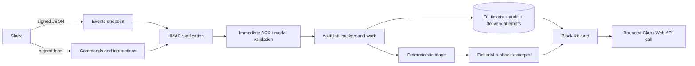

# Architecture and engineering decisions

## Boundaries

- `signature.ts`: exact-body HMAC and five-minute timestamp window, shared by
  JSON Events API and URL-encoded commands/interactivity.
- `triage.ts` / `runbooks.ts`: pure deterministic decisions and verbatim evidence.
- `tickets.ts`: parameterized SQL, workspace/channel scoping, role policy and
  optimistic version checks. Audit triggers execute in the same SQLite write
  transaction as the ticket mutation. No separately written audit can drift.
- `slack-ui.ts`: payloads checked against official `@slack/types` (dev-only).
- `support.ts`: route parsing, workspace restriction, modal validation and
  background orchestration. Never fetches caller-supplied `response_url` URLs.
- `slack-api.ts`: fixed allowed API methods, 2.5-second abort, sanitized errors.
  Legacy no-storage event mode keeps its five-second bounded transport.

## State and authorization

Tickets move from `open` to `in_progress`, `escalated` or `resolved`. A resolved
ticket is terminal. Claim is allowed only for configured support users and only
from open/escalated state; claim sets the actor as assignee. Requesters may
escalate or resolve their own tickets. Support users may escalate/resolve any
request in the configured workspace and originating channel. There is no
admin override endpoint, arbitrary reassignment or silent reopen.

`SLACK_TEAM_ID` restricts the supported installation. `SUPPORT_USER_IDS` is an
explicit allowlist of Slack user IDs for that workspace, not user-submitted
role metadata. Every ticket lookup/mutation is scoped by workspace and channel.
Non-support users can list/read only their own tickets through commands.
The source Slack channel already exposes cards to its members; this is not a
private HR/helpdesk system. Use a private test channel and fictional input.

Buttons carry ticket ID and version, not authority. A conditional SQL update
ensures one action wins for a version. Replays/stale clicks receive a private
explanation and cannot append another state-change audit row. Each successful
transition posts a fresh card in the original thread; older cards are stale.
`/caetano status ID` reads durable state, shows the latest 20 audit events and
returns an authorized current-version ephemeral card with buttons, so a failed
notification does not leave the workflow stuck on a stale card. Full audit
records remain in D1. Modal request details are visible in the card, not just
stored behind a hidden ID.

## Delivery guarantees

Ticket intake uses unique `(team, source_key)` keys. Events use the Slack event
ID; modal submissions use the view ID. Concurrent duplicate deliveries create
one ticket and one creation audit entry. They also reserve a unique delivery
attempt before contacting Slack, so duplicates do not start another initial
post. State transitions use unique per-version delivery keys.

This is **at most one automatic post attempt per delivery key**, not exactly-once
message delivery. There is no durable worker queue, leased outbox or recovery
process. A crash after reservation can lose the reply; a timeout can mean Slack
accepted the message even though the result is unknown. Failed attempts are
recorded as `failed`; crash/interrupted attempts can remain `attempted`.
Ticket and delivery reservation are separate writes: a replay can recover the
space between them, but no autonomous retry of an already reserved key occurs.
Notifications and D1 persistence are not a distributed transaction.

Modal validation errors are returned synchronously with `response_action:
errors`. Valid submissions ACK/clear before persistence; background DB failure
can lose that submission, and a best-effort private error asks the user to check
status before resubmitting. Acknowledgement means accepted for attempted work,
not durable completion. This tradeoff keeps webhook latency small without
pretending to provide a reliable queue.

A production next step would be an atomic inbox/outbox plus scheduled durable
consumer, bounded Retry-After handling and reconciliation of unknown outcomes.
Do not substitute an isolate-local Set for durable deduplication.

## AI choices and evaluation

The demo retrieves a category-matched excerpt only for the fictional supported
tools and cites its runbook ID/path. It does not generate with an LLM, so it is
not RAG or a semantic agent. Unknown evidence produces a question/escalation.
The optional model was deliberately not added: the small corpus does not need
it, and an unvalidated mock-only model integration would overstate experience.
A future grounded generator would need structured-output validation, citation
checks, deadlines, fallback and a separately reviewed free/local model setup.

`npm run eval` outputs category/route/action/source accuracy and per-category
counts for 24 synthetic development cases. The cases informed the rules; this
is not a held-out test, safety certification or production accuracy claim.
Negation and novel paraphrases remain limitations. Decisions use the first 280
normalized characters. There is no conversation memory beyond ticket state.

## Data, costs and retention

D1 stores up to 2000 characters of input per ticket plus Slack IDs and audit
metadata. Content is not automatically redacted: only synthetic/redacted data
belongs here. Logs never include tokens, input or upstream error messages.
No token, full signed payload, trigger ID or response_url is persisted.
There is no scheduled retention job; the owner must delete demo data when done.
Slack's own free-plan retention does not delete the D1 copy. External deletion
and workspace uninstall handling would be required for production.

The default installation is local D1; its UUID is a placeholder and no remote
resource has been provisioned. Nothing automatically enables a paid model,
Slack plan, Cloudflare plan or paid service. Owner provisioning must stay within
their available free limits; no unlimited capacity or current quota is claimed.
